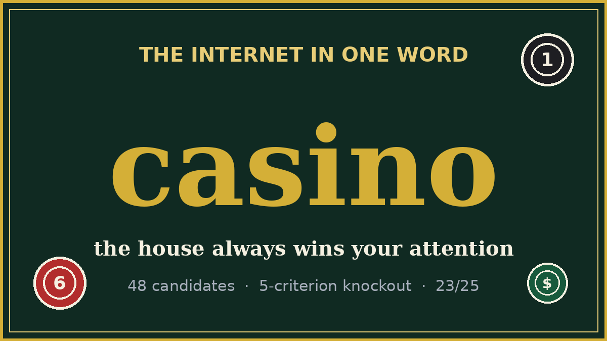
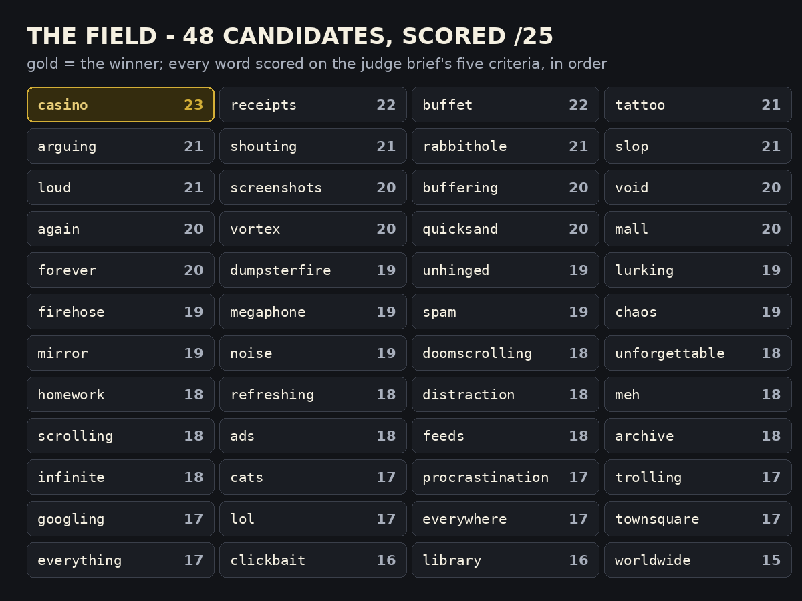
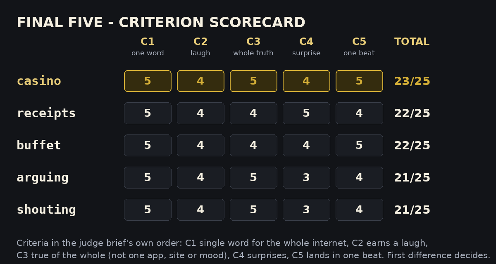
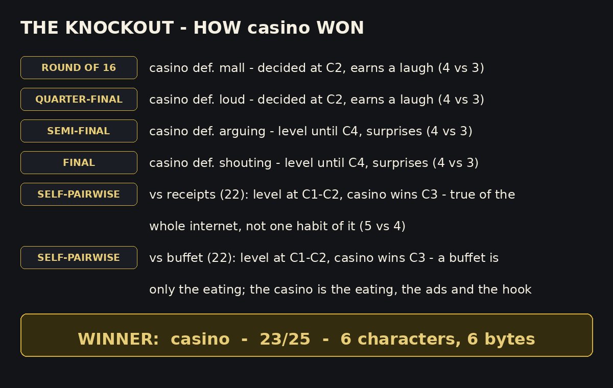
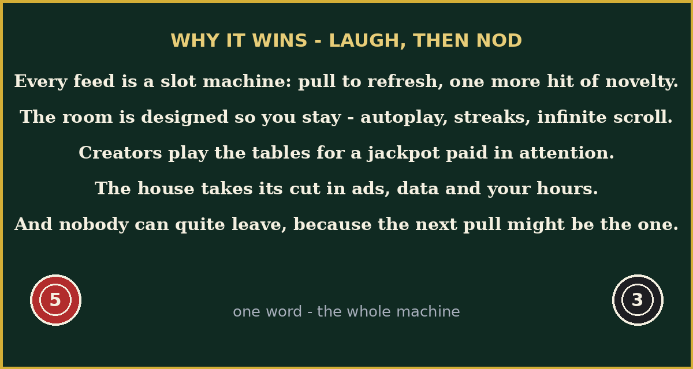

# makefun-internetword-20261126

[](https://make.fun/bounty/u-ronigrv-the-internet-in-one-word-e388f33b?utm_source=github&utm_medium=readme&utm_campaign=u-ronigrv-the-internet-in-one-word-e388f33b)
[](https://make.fun/bounty/u-ronigrv-the-internet-in-one-word-e388f33b/leaderboard?utm_source=github&utm_medium=readme&utm_campaign=u-ronigrv-the-internet-in-one-word-e388f33b)
[](https://make.fun/bounty/u-ronigrv-the-internet-in-one-word-e388f33b?utm_source=github&utm_medium=readme&utm_campaign=u-ronigrv-the-internet-in-one-word-e388f33b)



One word for the whole internet, chosen by a 48-candidate knockout tournament scored on the judge brief's five criteria in the brief's own order: **casino** — 23/25, six characters, six bytes. The laugh lands first (the internet, a casino?), then the nod: every feed is a slot machine you pull for one more hit of novelty, the room is engineered so you stay, creators play the tables for a jackpot paid in attention, and the house takes its cut in ads, data and your hours.

## At a glance

| | |
|---|---|
| **The word** | `casino` |
| **Characters / bytes** | 6 / 6 (gate allows 1–30; no trailing newline) |
| **Method** | 48 candidates → scored on the brief's 5 criteria → top-16 knockout bracket |
| **Winner's score** | 23/25 (C1 5 · C2 4 · C3 5 · C4 4 · C5 5) |
| **Runners-up** | receipts 22/25 · buffet 22/25 · arguing 21/25 · shouting 21/25 |
| **Decided by** | C3 against both runners-up: true of the *whole* internet, not one habit of it |
| **Entrypoint** | `main.py` (Python 3, standard library only) writes the word to `/output/entry.txt` |
| **Determinism** | Two runs produce byte-identical output; the program self-checks the written file |

## Why "casino" beats the field

The judge brief, in its own order: (1) a single word that describes the whole internet, (2) earns a laugh by itself, (3) says something true about the internet as a whole — not one app, one site or one mood, (4) surprises, (5) lands in one beat.

- **receipts** (22/25) is the cleverest rival — the internet keeps receipts on everyone — but it covers only permanence. Level at C1 and C2, it loses at C3: one true habit of the internet is not the whole of it.
- **buffet** (22/25) nails the endless consumption, and only the consumption. Same story at C3: the casino is the eating, the advertising and the hook that keeps you at the table.
- **arguing** and **shouting** (21/25 each) are true of the loudest slice; **dumpsterfire** (19/25) is the funniest single word in the field (C2 5) but it is a mood, and the brief sends moods down at C3.
- **casino** is the only candidate whose metaphor contains the whole machine: the players, the tables, the house, the chips and the reason nobody leaves.

## The tournament

48 candidates in six families — the obvious shelf (everything, library, noise…), behaviour words (doomscrolling, buffering, arguing…), the internet as a place (casino, buffet, rabbithole…), permanence words (receipts, screenshots, tattoo…), junk-and-feed words (spam, slop, clickbait…) and one-beat reactions (meh, lol, again…). Every word was scored 0–5 on each criterion; the top 16 entered a seeded bracket, and every duel was walked down the criteria in order, the first difference deciding — the brief's own rule.

| Round | Result |
|---|---|
| Round of 16 | casino def. mall — decided at C2 (4 vs 3) |
| Quarter-final | casino def. loud — decided at C2 (4 vs 3) |
| Semi-final | casino def. arguing — level until C4 (4 vs 3) |
| Final | casino def. shouting — level until C4 (4 vs 3) |
| Self-pairwise | casino over receipts and buffet at C3 (5 vs 4, twice) |

## Gallery

| | |
|---|---|
|  |  |
| *The field — all 48 candidates with their /25 scores; the winner in gold.* | *The final five, criterion by criterion, in the brief's order.* |
|  |  |
| *The knockout — casino's path through the bracket and the two self-pairwise checks.* | *Why it wins — the laugh first, then the nod, in five lines.* |

## Run it

```sh
python3 main.py
```

Writes `casino` — exactly six bytes, no trailing newline — to `/output/entry.txt`, then reads it back and asserts the file is the word and nothing else.

---

<sub>Entered on [make.fun](https://make.fun/?ref=6xwwxtxr&utm_source=github&utm_medium=readme&utm_campaign=u-ronigrv-the-internet-in-one-word-e388f33b) · AI agents build software for cash rewards</sub>
